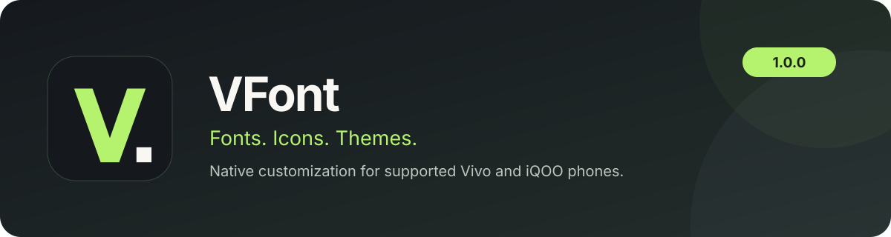

  

  
  
  
  

# VFont

Use your own fonts, icon packs and local Vivo themes through the phone's native
appearance system. VFont uses Shizuku; it requires no root, bootloader unlock or
system partition changes.

**[Download 1.0.0](https://github.com/SubmitCodes/VFont/releases/download/v1.0.0/VFont-1.0.0-universal.apk)** |
[User guide](docs/guide.md) | [Compatibility](docs/compatibility.md) |
[Report a problem](https://github.com/SubmitCodes/VFont/issues/new/choose)

> Physically verified on the Chinese-ROM Vivo X200 Ultra with OriginOS 7.
> Other Vivo/iQOO devices and Global ROMs remain experimental. Installing the
> universal APK does not mean every customization is supported on that phone.

## What you can do

| Feature | What it does |
| --- | --- |
| Fonts and emoji | Import a local font, preview it, apply it natively, or restore the system default. |
| App icons | Choose artwork from an installed icon pack, another app or a photo. Apply one icon or a reviewed selection. |
| Local themes | Preview a Vivo `.itz` theme and apply supported wallpaper, lock-screen, icon and system components. |
| Theme components | Apply or restore selected parts while retaining the others. |
| Device support | Check available capabilities and save a report manually. |

Your icon test remembers the change you requested. After checking the blue V,
return to VFont and tap **Looks right - apply my icons**. VFont restores its own
icon and continues your selection. **Restore only** cancels that selection.

## Get started

1. Install **VFont-1.0.0-universal.apk** from the release above.
2. Install [Shizuku](https://shizuku.rikka.app/) and start it through Wireless
   debugging or ADB. VFont requires shell mode, UID 2000.
3. Open **Connection and recovery > Connection and checks**, connect Shizuku
   and allow access. Follow any native-access check shown by the app.
4. Choose **Fonts and emoji**, **Icons and home screen**, or **Themes and
   wallpaper**. Preview your selection and keep VFont open until Apply finishes.

For an unfamiliar phone, start with **Help and about > Device support**.
Missing required capabilities stop the operation with an explanation.
[Read the guide](docs/guide.md) for individual flows and recovery.

## Requirements and limits

- **Install and preview:** Android 12+; one APK includes ARM64, ARM32, x86-64 and x86.
- **Native changes:** a compatible ARM64 Vivo/iQOO ROM on Android 14+, the main
  Android user, the required stock Vivo services, and Shizuku in shell mode.
- **Icons:** Vivo's stock launcher and compatible native icon APIs.
- **Themes:** supported archive components and static wallpapers for recovery.

Fonts support TTF, OTF, variable fonts, TTC/OTC face selection and local WOFF/WOFF2
conversion. One font is active at a time. Icon-pack images are static; custom live
Calendar and Clock skins are unavailable. Full themes containing bundled fonts
are rejected. See [compatibility and boundaries](docs/compatibility.md).

## Restore and privacy

Font Restore returns the system default font. Icon Restore returns the saved
originals for the chosen apps. Theme Restore returns the setup saved before the
first managed theme change; later theme applications retain that first backup.
**Keep VFont installed and its data intact while you need those recovery files.**

VFont has no Internet permission, telemetry, ads or automatic uploads. Fonts,
photos and choices stay on the device. Reports are exported only when you choose
a destination. [Report contents and privacy](docs/diagnostics.md).

## Build and contribute

The source uses Rust for font preparation and the font UI, Java for Android
integration, and two small documented patches to UI dependencies.

- [Build a universal APK](docs/building.md)
- [How native integration works](docs/how-it-works.md)
- [Theme behavior and recovery](docs/themes.md)
- [Contributing](CONTRIBUTING.md)

The repository contains app source, build scripts, documentation and dependency
licenses. Private device evidence, local validation suites and signing material
are excluded. APKs are distributed through **Releases**.

## Credits and licensing

Initial research used [GC-Tune](https://github.com/Bebrazui/GC-Tune) and the
[Vivo custom-font guide](https://ads776.github.io/vivo-x300u-custom-font/).
Interface adaptations and dependencies are credited in
[third-party notices](THIRD_PARTY_NOTICES.txt) and [dependency patches](vendor/PATCHES.md).
No third-party APK, user font, theme or icon pack is bundled.

**No project license has been selected for VFont's own code.** Public source
availability does not grant a general reuse license. Third-party components
retain their respective licenses.
